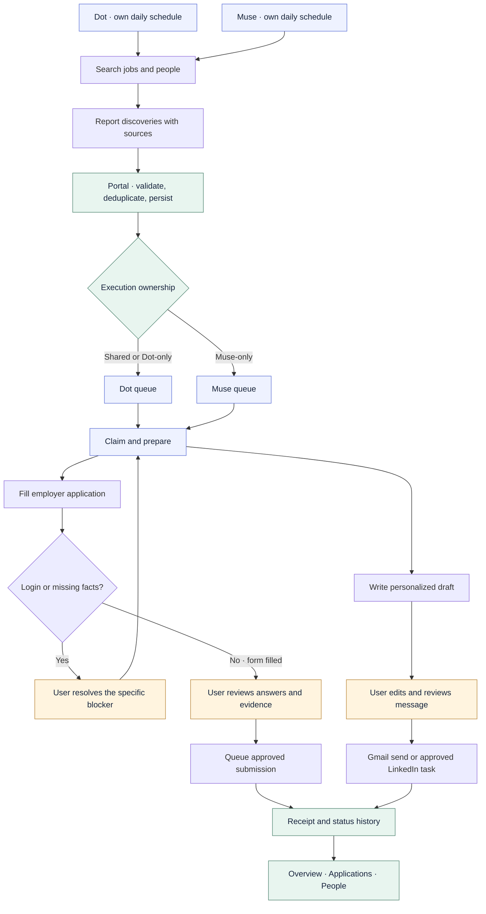
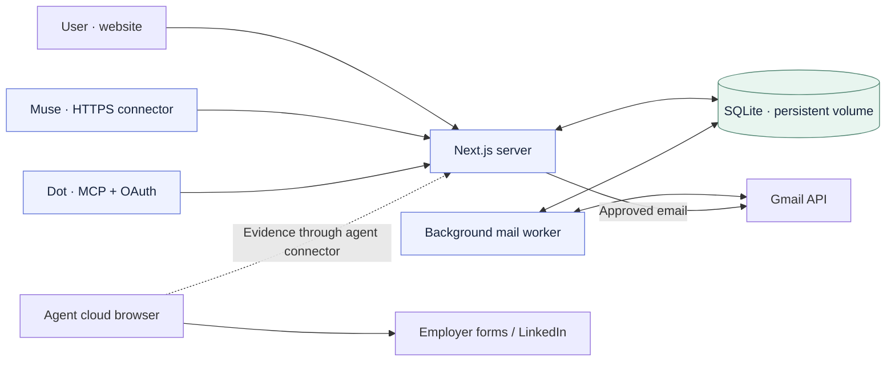

# Career Compass

**Your agents do the legwork. Your workspace keeps the whole story.**

[English](README.md) · [简体中文](README.zh-CN.md)

Career Compass is a private job-search and outreach workspace built with Next.js. It brings opportunities, applications, contacts, drafts and conversation evidence into one place while existing personal agents—ChatGPT Dot and Muse—search, interpret, draft and prepare applications.

The product is designed for a simple daily experience: **agents work independently, the portal reconciles their results, and you review the final applications and messages.** That is the intended workflow; each agent's scheduling, authentication and browser execution must be validated separately.

## Why a portal when personal agents already exist?

A chat or Markdown tracker can collect useful work. It becomes harder to answer: Have I already applied? Did either agent contact this person? Was that email delivered or bounced? Where is the actual draft, and what needs my attention?

Career Compass provides a durable record across those conversations:

- **One identity, multiple sources.** Preserve who discovered a job or person while reconciling duplicate records.
- **Clear responsibility.** Shared and Dot-only discoveries go to Dot; Muse-only discoveries go to Muse. Existing execution assignments remain stable.
- **A place to take over.** Search contact cards, inspect evidence, edit a draft and continue without retelling the history in chat.
- **Evidence-based progress.** A found job is not an application, a draft is not a send, and an accepted email is not proof of delivery.
- **Actionable exceptions.** Login requirements, missing answers, duplicate concerns and uncertain submissions are distinct from work ready for review.

## The workflow



Daily discovery is initiated by each agent's native schedule, even when the website's Tasks list is empty. A shared `roundKey` groups both reports. Automatic discovery rounds release preparation after reconciliation; manually configured rounds require release. **Tasks also provides a shared inbox for one-off requests and temporary changes. It does not wake an external agent.**

Agents must check the queue, claim assigned work, renew the claim, save results and read them back. Polling every ten minutes is an agent configuration, not a guarantee that every task finishes within ten minutes.

## Responsibilities and boundaries

| Component | Responsibility |
| --- | --- |
| Dot / Muse | Find and verify opportunities and contacts; interpret evidence; write drafts; operate an employer form in their own supported browser; return results |
| Career Compass | Shared records, provenance, deduplication, ownership, execution queue, claim leases, approval state, editable drafts and dashboards |
| Gmail integration | Authorized mail retrieval, application/contact evidence and approved email sending; a background worker runs independently of page visits |
| User | Provide accurate personal facts, complete account login when required, resolve ambiguities, review final content and authorize sending/submission |

The website **does not call a model API** to write drafts or run a separate autonomous agent. Model-based work stays with connected personal agents. The website's own job-feed collection has been removed; new jobs come from agents or manual entry.

Muse can use a secure HTTPS connector. Dot can use remote MCP with OAuth. Both access the same backend contract. Connecting to the portal does **not** grant employer-site or LinkedIn login: those require separate sessions in each agent's supported browser. LinkedIn messages are agent-reported; there is no direct LinkedIn inbox API integration here.



## What the screens contain

| Screen | Purpose |
| --- | --- |
| **Overview** `/` | Application stages, outreach progress and next actions |
| **Opportunities** `/jobs` | Deduplicated job records, original links, fit, deadlines, sponsorship evidence and execution ownership |
| **Applications** `/applications` | Actual application records, editable tracking and recent Gmail evidence |
| **People** `/people` | Searchable contact cards, relationship, email/LinkedIn status, provenance and conversation links |
| **Outreach** `/outreach` | Search contacts, review/edit agent drafts, individual or batch sends and draft progress |
| **Tasks** `/tasks` | One-off requests, discovery rounds, execution queue, blockers and application review |
| **Agents** `/agents` | Connection setup and reported activity |
| **Data** `/data` | Inspect stored jobs, people and archived website leads |
| **Settings** `/settings` | Profile, preferences, Gmail permissions and data recovery |

People and Opportunities paginate at 30 records. Contact search covers the whole saved library before pagination. In Outreach, search filters the contact queue while keeping the current draft open until you select another person.

## From queued to review

| State | Meaning / next action |
| --- | --- |
| `queued` | Assigned; the owner agent must claim and execute it |
| `claimed` | A live claim exists; inspect progress rather than assuming completion |
| `needs_login` | **Sign up / Sign in** in the agent's employer-site browser, then click **I've signed in — continue filling** |
| `needs_input` | **Needs your answers**; supply missing facts, then click **Information ready — continue filling** |
| `review` | Application preparation reports a filled form, answers, evidence and no unresolved questions; user review is now available |
| `blocked` | Read the reason and task result; resolve the issue before retrying |
| `uncertain` | Verify whether the external action happened before attempting it again |
| `completed` | This task finished; check its kind and receipt—draft completion does not mean an email was sent |

Resuming preparation returns the original task to the original agent. It does not authorize submission. Final submission requires a separate approved task. Unfilled forms must not be represented as ready for review.

## Data design

SQLite is the single business store, holding the workspace, jobs, contacts, drafts, mail events, task rounds, claims and audit records. Canonical job links/identifiers and confirmed LinkedIn identities support deduplication; weaker matches can be held as possible duplicates rather than silently merged. Stable event IDs make retries idempotent. Claims coordinate execution, and record versions protect against stale updates.

Email provenance and outcome are separate: public versus inferred address, reported sending, Gmail evidence, reply and bounce should not collapse into one “verified” flag. Unknown job requirements remain unknown until supported by evidence.

Local development uses `.data/career-compass.sqlite`. Cloud deployment uses a persistent volume, normally `/data/career-compass.sqlite`, with one application replica. Use consistent SQLite backups for migration. Keep the cloud database authoritative after cutover; do not keep two independent production writers.

## Development and deployment

Requires **Node.js 24+**. Stack: **Next.js 16 / React 19 / TypeScript / SQLite**.

```bash
npm install
npm run setup:local
npm run dev
```

Open `http://127.0.0.1:3000`. Configure `.env.local` following [Local setup](docs/LOCAL_SETUP.md). Run `npm run worker` in a separate terminal for authorized Gmail synchronization.

For Railway, follow [Deployment](docs/DEPLOYMENT.md): configure the workspace login, HTTPS origin, Google OAuth callback and persistent `/data` volume. `npm run start:cloud` starts the application and mail worker. External agents keep their own schedules and credentials; deploying the site does not install or start them.

Never commit `.env.local`, `.data/`, mail exports, resumes or access tokens. Keep credentials in the deployment environment and agent-supported secure connections.

```bash
npm run lint
npm run typecheck
npm test
npm run build
```

Tests use temporary data and simulated integrations. Passing them does not prove that an external agent can run unattended.

## Acceptance: prove the complete path

Use an existing real round before adding more test tasks:

1. Verify each agent's cloud identity and a fresh queue read.
2. Observe existing work move from queued to claimed and save actual discoveries.
3. Confirm duplicate reconciliation, preserved sources and one execution owner per record.
4. Verify the owner opens and fills the actual employer form, or returns a specific login/input blocker. Verify the draft is saved in Outreach.
5. Review final content, authorize the chosen action, and inspect its actual receipt.
6. Check a later independent scheduled run, credential reuse and reply/bounce synchronization.

API access, scheduling, browser login, form completion and final sending are **separate acceptance checks**. A successful connection or a saved schedule alone is not an end-to-end pass. Cloud portal access can avoid using your Mac; external-site browser capabilities still need validation.

Further reading: [Collaboration workflow](docs/COLLABORATION_WORKFLOW.md) · [MCP OAuth](docs/MCP_OAUTH.md) · [Original project brief](docs/PROJECT_BRIEF.md).
