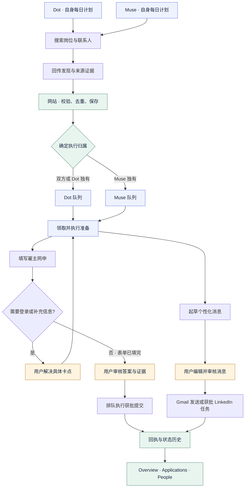
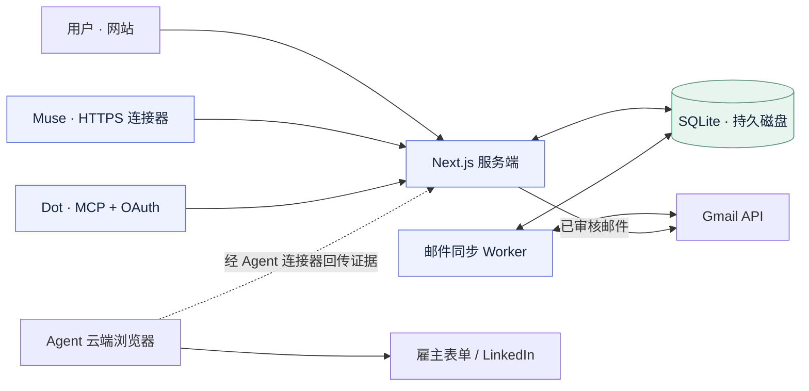

# Career Compass

**Agent 负责执行，网站让求职全过程可见、可追踪、可接手。**

[English](README.md) · [简体中文](README.zh-CN.md)

Career Compass 是基于 Next.js 的私人求职与外联工作台，将岗位、投递、联系人、草稿和沟通证据集中管理。ChatGPT Dot 与 Muse 等已有 Personal Agent 负责搜索、理解、起草和网申准备。

期望的日常体验是：**两个 Agent 独立开展工作，网站去重并分配后续执行，你在最终网申和消息发送前审核。** 这是产品的目标流程；每个 Agent 的定时运行、认证和浏览器执行能力仍需分别验收。

## 已经有 Personal Agent，为什么还需要网站？

聊天和 Markdown 表格可以记录工作，但随着任务增加，很难立即回答：这个岗位是否已经投过？两个 Agent 是否联系了同一个人？邮件到底发出、退信还是收到回复？哪份草稿才是最新的？

网站提供跨对话、持续保存的业务记录：

- **一份对象，多份来源。** 合并重复岗位和联系人，同时保留 Dot / Muse / 双方发现的来源。
- **明确执行归属。** 双方发现及 Dot 独有发现由 Dot 执行；Muse 独有发现由 Muse 执行。已经确定的执行分配保持稳定。
- **随时接手。** 搜索个人名片、查看证据、修改草稿，无需重新在聊天里解释上下文。
- **以证据区分进度。** 找到岗位不等于已申请，草稿完成不等于已发送，Gmail 接受发送也不等于对方收到。
- **把卡点变成可处理事项。** 登录、缺失答案、疑似重复、提交结果不确定，与真正等待审核的网申分开显示。

## 完整流程



日常搜索由两个 Agent 各自的原生定时计划触发，**不依赖网站 Tasks 是否为空**。同一轮使用相同 `roundKey` 汇总发现。自动轮次在协调完成后释放准备任务；配置为手动分配的轮次需要释放操作。Tasks 同时承接临时新增需求与共同调整，网站本身不能唤醒外部 Agent。

Agent 需要主动查队列、领取归属任务、续期、保存结果并读回。每 10 分钟检查属于 Agent 的运行配置，并不意味着每个任务都能在 10 分钟内完成。

## 各方负责什么

| 组件 | 职责 |
| --- | --- |
| Dot / Muse | 搜索并核查岗位和联系人；理解证据；起草消息；在各自支持的浏览器里填写网申；回传结果 |
| Career Compass | 统一记录、来源、去重、归属、任务队列、领取租约、审核状态、可编辑草稿与可视化 |
| Gmail 集成 | 经授权读取邮件、更新申请与联系人证据、发送审核后的邮件；后台同步不依赖页面保持打开 |
| 用户 | 提供真实个人信息、完成必要的账号登录、处理歧义、审核最终内容并授权发送或提交 |

网站**不调用模型 API**生成草稿，也不另建一个自主 Agent。需要模型理解与生成的工作由已有 Personal Agent 完成。网站自己的岗位 feed 采集已移除，新岗位来自 Agent 或人工录入。

Muse 可使用安全 HTTPS 连接器，Dot 可使用带 OAuth 的远程 MCP，两者访问同一套业务后端。连接网站不等于获得雇主站或 LinkedIn 登录权限；这些网站需要在各 Agent 支持的浏览器中单独登录。LinkedIn 会话由 Agent 读取后回传，网站没有直接接入 LinkedIn 私信 API。



## 页面分工

| 页面 | 用途 |
| --- | --- |
| **Overview** `/` | 申请各阶段、外联进度与下一步 |
| **Opportunities** `/jobs` | 去重后的岗位、原始链接、匹配原因、截止时间、sponsor 证据及执行归属 |
| **Applications** `/applications` | 真实投递记录、可编辑追踪与近期 Gmail 证据 |
| **People** `/people` | 可搜索的联系人名片、关系、邮箱和 LinkedIn 状态、来源与会话链接 |
| **Outreach** `/outreach` | 搜索联系人、审核编辑 Agent 草稿、逐条或批量发送、查看草稿进度 |
| **Tasks** `/tasks` | 临时需求、搜索轮次、执行队列、卡点与网申审核 |
| **Agents** `/agents` | 连接设置及已回传活动 |
| **Data** `/data` | 查看数据库中的岗位、联系人和归档网站线索 |
| **Settings** `/settings` | 个人资料、偏好、Gmail 权限与数据恢复 |

People 与 Opportunities 每页最多 30 条。联系人搜索先查整个已保存库，再分页。Outreach 搜索筛选联系人队列，选择另一个人前保留正在编辑的草稿。

## 从排队到审核

| 状态 | 含义及下一步 |
| --- | --- |
| `queued` | 已分配，等待归属 Agent 领取并执行 |
| `claimed` | 有有效认领；需要结合实际进度和结果判断执行情况 |
| `needs_login` | **Sign up / Sign in**：在 Agent 的雇主站浏览器完成登录，再点 **I've signed in — continue filling** |
| `needs_input` | **Needs your answers**：补充缺失事实，再点 **Information ready — continue filling** |
| `review` | 网申准备报告了已填表单、答案、证据且无未解决问题；进入人工审核 |
| `blocked` | 阅读原因和任务结果，解决具体问题后再重试 |
| `uncertain` | 先核实外部是否已经发送或提交，不能直接重试 |
| `completed` | 当前任务完成；结合任务类型和回执理解，草稿完成不代表邮件已经发送 |

恢复填写会把原任务交还原 Agent，不代表授权提交。最终提交需要单独的获批任务。未打开或未填完的表单不能显示成可提交的 Review。

## 数据设计

SQLite 是唯一业务库，保存工作区、岗位、联系人、草稿、邮件事件、轮次、认领与审计记录。岗位的规范化链接/标识、已确认的 LinkedIn 身份用于去重；证据较弱的匹配可能进入疑似重复状态，不强行合并。稳定的事件 ID 保证重试幂等，领取租约协调执行，版本号避免旧数据覆盖新修改。

邮箱来源与联系结果分别记录：公开地址或推断地址、Agent 报告已发、Gmail 证据、回复和退信，不混为一个“已验证”。未知岗位要求保留未知，等待证据补充。

本地数据库为 `.data/career-compass.sqlite`；云端位于持久磁盘，通常为 `/data/career-compass.sqlite`，应用运行单实例。迁移使用一致性 SQLite 备份，切换后以云端为正式库，避免本地与云端分别写入两套生产数据。

## 开发与部署

需要 **Node.js 24+**。技术栈：**Next.js 16 / React 19 / TypeScript / SQLite**。

```bash
npm install
npm run setup:local
npm run dev
```

打开 `http://127.0.0.1:3000`。按[本地接入步骤](docs/LOCAL_SETUP.md)配置 `.env.local`，另开终端运行 `npm run worker`，进行经授权的 Gmail 同步。

Railway 按[部署说明](docs/DEPLOYMENT.md)配置工作区登录、HTTPS 地址、Google OAuth 回调及 `/data` 持久磁盘。`npm run start:cloud` 同时启动网站和邮件 Worker。外部 Agent 仍维护自己的计划与凭据，部署网站不会替它们安装或启动计划。

不要提交 `.env.local`、`.data/`、邮件导出、简历或访问 token。凭据保存在部署环境及 Agent 支持的安全连接中。

```bash
npm run lint
npm run typecheck
npm test
npm run build
```

测试使用临时数据与模拟集成；通过检查不等于已经证明外部 Agent 能无人值守运行。

## 如何验收完整链路

先沿用已有真实轮次，不反复新增测试任务：

1. 确认每个 Agent 的云端身份及一次新的队列读取。
2. 观察已有任务从 queued 变为 claimed，并真实保存发现。
3. 核对重复合并、来源保留及每条记录唯一的执行归属。
4. 核对 Agent 实际打开并填写雇主表单，或报告具体登录/资料卡点；核对 Outreach 已保存草稿。
5. 审核最终内容，授权选定操作，并检查实际回执。
6. 再验证一次独立定时运行、凭据复用及回复/退信同步。

API 连通、定时触发、浏览器登录、填表完成和最终发送，是不同的验收项。仅有连接成功或计划已保存，不代表全流程通过。云端接口可避免占用你的 Mac，但外部网站的浏览器执行能力仍需实测。

更多文档：[协作流程](docs/COLLABORATION_WORKFLOW.md) · [MCP OAuth](docs/MCP_OAUTH.md) · [原始需求](docs/PROJECT_BRIEF.md)。
