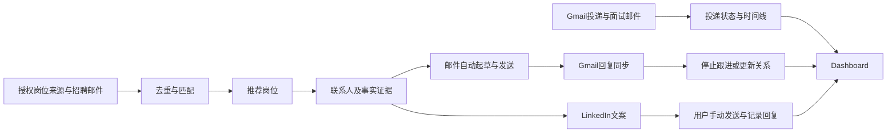

> **日常流程修正（policy 2026-11-05.6）**：日常搜索、外联目标与监测由 Dot/Muse 各自原生计划管理；网站不保存默认每日计划或配额。Tasks 仅承接临时调整/新任务。Agent 主动回传发现，网站去重、记录执行归属、提供审核与汇总。空 Tasks 不影响原生日常工作。参见 DOT_MUSE_HANDOFF.md 与 COLLABORATION_WORKFLOW.md。

> **2026-11-05 最新决定（覆盖下文旧阶段记录）**：岗位发现只由 Dot/Muse 执行，双方搜索同一完整范围。网站自动岗位采集代码已删除，旧来源接口返回 410；历史网站线索移至 `archived_jobs`，在 Data 可读。网站保留 Gmail API 事实同步、Agent 输入校验/去重、任务领取/归属、编辑与发送。网站不调用模型，不会直接唤醒 Personal Agent。外部定时与权限仍需逐个验证，不能把页面可访问当成自动运行成功。详见 COLLABORATION_WORKFLOW.md。

# Career Compass｜项目需求与实施交接

> **最新产品决策（2026-11-04，优先于下文历史方案）：** 以 Muse / ChatGPT Dot 执行搜索、起草和语义判断，网站提供共享记录、去重、名片与时间线、草稿编辑、用户点击发送和进度汇总；不购买或调用网站自己的模型 API。Dot 优先负责其发现的全部联系人，Muse 负责独有联系人。Gmail API 提供事实与邮件跳链，Agent 可基于原文解释状态。采用本机 SQLite；直接回传接口已实现，但真实双 Agent 连接及发信授权仍待验收。实现边界、操作步骤和文件位置见 [AGENT_PORTAL_MVP.md](AGENT_PORTAL_MVP.md)。

版本：v1.1
整理日期：2026-11-03（America/New_York）  
用途：作为新 Project 的需求来源、产品方案和开发交接文档。  
项目名称：Career Compass（用户已确认）。

## 1. 阅读方式与当前状态

本文件合并用户明确要求、后续确认和已接受的产品方案。标注为“方案默认”的内容来自助手建议，用户总体同意实施，但不代表逐项提出过这些数值。新 Project 应保留已确认决策，只对真正影响实施且尚未明确的事项提问。

**当前实施状态（2026-11-04 更新）：英文前端和本地真实数据接入已实现，云端路线尚未部署。**

- 用户已选择 SQLite，无需创建 Supabase。下文云端架构保留为候选方案，不代表必须迁移。
- 资料：五份本人材料已提取为英文介绍及 PM / DS / DA 草稿素材；保留来源，不默认使用版本间不一致的成果数字。
- Opportunities / People：桌面三列、每页 30 条，紧凑摘要卡片，详情弹窗；来源管理移至 Settings。类别与发布日期筛选横向排列。联系人单独显示 To Be Connect / Connected。Applications 邮件全局状态筛选移除；正文自动判断状态，保留逐封纠错；邮件和追踪各每页 20 条。
- 本地工作区 765 条岗位线索；来源库包含全部 39 家指定雇主，25 家直接来源本轮采集完成、9 家部分覆盖、5 家失败。共 61 个入口，不把入口或页面检查等同于完整爬虫。
- Gmail 只读授权已接通，最新要求为最近 30 天；旧事件不删除但不进入当前列表。当前 40 条可见求职邮件，回溯遇 Google 限流，断点保留。无需重新配置授权。
- LinkedIn 公开最近 24 小时职位卡片已部分采集；联系人、草稿与连接状态手动记录，不绕过登录墙、不读取私信。Outreach 指标只放 Email，按手动邮件记录统计。
- Company bucket 自动填写并附理由；未知企业保留 Other / review needed，非科技成熟企业单列，不虚构分类凑比例。TikTok 美国岗位保留。
- 岗位页打开时对过期来源每小时刷新并合并证据，显示采集时间；不等于实时推送。邮件支持 HTML 正文、去除引文和正确邮箱的 Message-ID 定位。未完成自动发送、全站爬取、Pub/Sub、后台定时任务、云端认证或部署。
- Git 仓库及代码在本地；尚未推送 GitHub 或部署 Vercel。关机时本机后台停止。
- 下文保留完整产品目标；“要求实现”不代表“当前已接通”。实际操作与文件说明见 [LOCAL_SETUP.md](LOCAL_SETUP.md)。

## 2. 产品目标

建立一个求职网站，把“发现岗位 → 寻找联系人 → 外联 → 投递 → 面试 → offer”整合成一个持续更新的工作台，前期仅供单用户使用，后期可能推广到多用户

主要价值：减少手动整理邮件、重复搜索岗位和跟进外联的工作；让用户知道目前求职进展、今天该做什么、哪些机会值得优先处理。

### 2.1 用户明确要求与最终决策

| 主题 | 用户要求 / 已确认决策 |
|---|---|
| 使用对象 | 前期个人使用，后期多用户 |
| 开发方式 | AI 协助写代码，搭建独立网站 |
| 目标岗位 | 科技行业的 PM / DS / DA，以校招、new grad、entry-level 为主 |
| 地区 | 美国为主线，香港、新加坡、欧洲等为辅；各地区同时看当地企业与中国出海企业 |
| 公司 | 重点关注中大型科技企业及中国出海企业，也保留初创和小企业窗口 |
| 公司线索 | 用户提到 TikTok 之外的出海企业，如腾讯、转转；这些是研究线索，不代表已确认有适合岗位 |
| 岗位来源 | 希望覆盖 LinkedIn、Simplify、Jobright.ai 等最新岗位；“Jobsright”已澄清为 Jobright.ai |
| 工作授权 | 用户是 international student，需要用 OPT；过滤明确表示不支持 sponsorship 的岗位 |
| Gmail | 自动识别投递成功、拒绝、面试等信息，在 Dashboard 持续更新 |
| Networking | 优先中国人、Yale 校友、中央财经大学校友，再扩展到其他相关联系人 |
| 邮件外联 | 自动起草、自动发送、自动追踪回复，不希望逐封人工点击发送 |
| 邮件频率 | 用户选择“每天10封＋两次跟进”的选项；第7天和第14天跟进 |
| LinkedIn 最终范围 | 针对具体联系人和具体机会起草文案，用户手动发送并关注、记录回复 |
| 代码可见性 | 用户希望能持续查看代码及修改，理解如何 review，代码由自己掌握 |
| 版本管理 | 希望尽早存到 GitHub；初版可运行框架完成后建立私有仓库，之后按功能保存版本 |

### 2.2 原话摘录：保留关键意图

> “连接gmail记录查看我已经成功投递/拒绝/面试的信息，做一个dashboard，实时更新进度”

> “我主要看tech行业的PM/DS/DA工作”

> “过滤掉明确说不支持sponsor的岗位，因为我是international student，需要用OPT”

> “介绍自己的背景+表明对ta的欣赏+对这个岗位的兴趣，问一下能不能要referral，或者coffeechat？”

> “邮件全自动外联，linkedin的话 帮我实现针对xx起草xx，然后我可以手动发送+关注回复”

> “美国主线，香港/新加坡/欧洲等为辅，both看当地企业和中国出海企业”

## 3. 已选技术路线与代码归属

采用 **Codex 辅助开发 + Next.js + Supabase + Vercel + Gmail API + AI API**。

产品集成渠道包括 **Gmail、LinkedIn，以及企业官网 / ATS / Simplify / Jobright.ai 等岗位来源**；各渠道的接入方式与可用能力分别验证。

| 层级 | 方案 | 用途 |
|---|---|---|
| 界面及网站接口 | Next.js | Dashboard、岗位、投递、人脉、外联和设置页面 |
| 账号与数据 | Supabase | 登录、数据库、访问控制、后台任务基础设施 |
| 网站部署 | Vercel | 提供独立访问网址 |
| 邮件连接 | Gmail API / Google OAuth | 读取相关邮件、自动发送、回复同步 |
| 邮件事件 | Google Cloud Pub/Sub + Gmail watch | 接收邮箱变化通知，再拉取增量数据 |
| LinkedIn 渠道集成 | 联系人主页链接、资料来源关联、AI 文案、手动外联状态 | 针对具体联系人和岗位起草消息，复制并跳转 LinkedIn，由用户发送和记录回复；授权搜索能力可用时再接入 |
| 岗位来源集成 | 企业官网、获准的 ATS 接口、招聘订阅邮件；LinkedIn / Simplify / Jobright.ai 来源适配 | 各来源独立接入并标明连接状态，只有确认接口及授权后启用自动采集 |
| 智能处理 | AI API | 分类、匹配、个性化文案；具体模型在实施时按成本和效果选择 |
| 版本与备份 | Git + GitHub 私有仓库 | 保存代码、修改历史、审查及回退 |

**LinkedIn 是产品集成渠道。**其界面、文案和联系记录由 Next.js、AI API 与 Supabase 实现。当前聊天里的 LinkedIn 搜人连接器不会自动成为独立网站可调用的 API；网站若需自动查询，必须另行验证可用授权。第一版必须包含 LinkedIn 辅助外联功能，不依赖私信自动发送或读取接口。LinkedIn 岗位来源与人脉外联是两个独立接入范围，分别验证。


代码先写入新 Project 的本地工作目录；当前聊天目录只是历史交接位置，不应硬编码成新项目路径。GitHub 保存源代码，Vercel 运行网站，Supabase 保存业务数据。上传 GitHub 与部署网站是不同步骤。

网站部署后应能在用户关闭电脑或聊天时继续运行后台任务。不能用“浏览器打开时刷新”冒充无人值守同步。

开发协作默认：在 Codex 入口查看 Diff / Review；如需完整文件树和持续查看源文件，可同时用 VS Code 打开同一目录。无需逐字直播代码输入。按功能提供预览、修改摘要、测试结果和阶段性 Git 提交。

## 4. 功能需求

### 4.1 Gmail 同步与投递追踪

- 首次默认回溯最近30天的求职相关邮件，随后增量同步；旧180天游标自动重建，界面也只展示滚动30天窗口。
- 使用 Gmail 推送触发更新，配合定时补偿同步；自动续期 watch 订阅。
- 显示最近成功同步时间、连接异常和需要重新授权的状态。“实时”按近实时目标实现，不承诺零延迟。
- 识别公司、岗位、确认投递、测评、面试、拒绝、offer，关联到具体投递。
- 状态包括：已收藏（Saved）、待投递（To apply）、已投递（Applied）、测评（Assessment）、面试（Interview）、Offer、拒绝（Rejected）。删除撤回阶段；已有撤回记录迁移为 Saved 并保留历史备注。
- 投递状态与联系人外联状态分开记录；对方回复不等于获得面试。
- 每次自动判断保留来源邮件链接、证据片段和置信度。
- 不确定邮件进入待确认区；人工纠正不能被后续自动同步静默覆盖。
- 同公司不同岗位分别记录；无法可靠关联时不强行合并。
- 点击 Apply 只记录访问；投递成功依赖确认邮件或用户人工标记。

### 4.2 岗位发现、公司与地区筛选

- 覆盖 PM / DS / DA；以 new grad、entry-level 为默认级别。
- 排除明显 senior、staff、director 岗位；用户可调整筛选。
- 默认每6小时同步已接通的数据源，并支持手动刷新和添加链接。
- 优先企业招聘官网、获准使用的 ATS 接口、订阅邮件；跨来源去重。
- LinkedIn、Simplify、Jobright.ai 保留来源入口；自动采集取决于有效接口与访问授权，不能承诺全量覆盖。
- 区分岗位发布时间、首次发现时间、最后核验时间；标记过期与下架。
- 美国为优先推荐地区；香港、新加坡、欧洲提供独立窗口，欧洲保留具体国家。
- 当地企业和中国出海企业都要覆盖；公司分类保留依据，不凭名称推断。
- 推荐理由结合简历和岗位要求，展示优势与缺口，不能只给匹配分数。
- 用户更新确认的推荐窗口：中大型科技企业60%、中国出海企业20%、初创与小企业20%；不足时不凑数。标签可能重叠，统计与展示应避免同一岗位重复占位。

**TikTok 偏好（2026-11-04 明确更新）：**用户要求查看 TikTok 美国岗位，不默认排除 TikTok。实际工作区和新工作区均关闭该公司排除项；明确不支持 sponsorship 的独立筛选仍按用户偏好生效。

### 4.3 工作授权与 sponsorship

美国岗位分别记录以下信息，均使用“支持 / 不支持 / 未知”并附原文证据：

1. 当前 OPT 是否接受。
2. STEM OPT 相关要求是否满足或可核实。
3. 未来是否提供签证 sponsorship。

- 明确不支持 sponsorship 的岗位默认隐藏，但可在排除列表查看原因。
- 未提及 sponsorship 的岗位保留并标注未知。
- 公司历史签证记录不能等同于当前岗位支持 sponsorship。
- 冲突信息显示待核实，不能自动当作支持。
- 非美国岗位分别记录当地工作授权要求，不套用 OPT 规则。
- 用户自身毕业、工作授权和可入职时间由本人填写，不推断法律资格。

### 4.4 人脉推荐

- 围绕目标公司和具体岗位推荐同团队员工、相关岗位员工、招聘人员及校友。
- 保留用户对中国人、Yale、中央财经大学校友的偏好。系统只使用本人公开声明、明确教育经历、公开语言信息或用户提供的信息；可以通过姓名辨别是否为中国人
- 通过可用授权搜索、公开职业资料、用户添加的 LinkedIn 链接补充资料。
- 每人展示任职信息、关系依据、岗位关联、推荐原因、资料来源及联系渠道。
- 邮箱必须有来源；格式、域名校验不等于确认邮箱属于本人，也不等于保证可投递。
- 资料不足时不编造联系人、邮箱、校友关系或个人经历。

### 4.5 邮件全自动外联

完成资料与发送规则配置后，由后台自动筛选联系人、起草、发送和跟进，无需逐封确认。

**用户已选规则：**每天最多10封首次外联，第7天与第14天各跟进一次。

**方案默认的配套规则：**

- 首次邮件与跟进合计每天最多20封；额度不足顺延，不为凑数量降低质量。
- 同公司7天内最多联系2人；同一人只允许一个活跃外联序列。
- 按收件人当地工作日白天发送；时区未知使用 America/New_York。
- 首次邮件默认英文，约100–150词。
- 结构：真实个人背景 → 有证据的联系理由或欣赏 → 相关岗位 → 一个明确请求。
- 有明确岗位且适合时询问 referral；以了解经历、建立关系为主时邀请简短 coffee chat。
- 无足够事实支撑时跳过或进入待补充，不捏造欣赏内容。
- 真实回复、明确拒绝、退信或停止联系请求到达后取消后续跟进。
- 自动回复暂缓并进入关注列表；发送前再次检查回复和联系人状态。
- 自动生成新的冷启动外联及未回复跟进；真实对话回复进入待处理，不擅自自动进行持续对话。
- 提供待发送预览、发送日志、排除名单、总暂停开关。
- 超时或重试前核对发送结果；结果不确定时暂停该任务核实，避免重复发信。

### 4.6 LinkedIn 辅助

- 针对具体联系人、其背景和具体岗位生成可编辑文案。
- 支持 referral 与 coffee chat 两类目的，每条消息只保留一个主要请求。
- 一键复制文案、打开联系人主页；由用户手动发送。
- 手动标记未发送、已发送、已回复、已约聊、不再联系，并设置关注时间。
- 不自动发送私信，不宣称自动读取回复；与邮件共享联系人记录以减少重复触达。

## 5. 页面与产品图

导航：Overview、Opportunities、Applications、People、Outreach、Settings。

2026-11-03 更新确认：
- Overview 核心指标使用 Applied；下方第二行展示完整 Application progress，增加 To apply。移除顶部发现机会按钮和原右侧全部卡片；岗位列表下方以同样的横向条目展示联系人，均提供跳转入口。
- Applications 默认可编辑表格，支持手动新增及修改公司、职位、地点、阶段、截止时间、投递时间、原始 JD 链接和备注；看板与概览共用状态并实时同步。保留 Add opportunity 跳转岗位发现。
- Opportunities 每张卡展示截止时间、sponsorship、核心 JD、关联点及原始 JD 链接；未知字段明确标注，不编造示例岗位的真实链接。
- Outreach 桌面端联系人队列与文案面板等高；窄屏改为纵向布局。

| 页面 | 主要内容 |
|---|---|
| 今日概览 | 投递与面试指标、今日行动、岗位推荐、联系人推荐、时间线、同步健康状态 |
| 岗位发现 | 地区/岗位/级别/公司类别/授权筛选、岗位详情、来源、匹配理由、收藏与申请入口 |
| 投递追踪 | 可编辑表格与同步看板、手动新增和纠正、关联邮件、面试及投递时间线 |
| 人脉推荐 | 联系人卡片、关系证据、关联岗位、邮箱与 LinkedIn 文案 |
| 外联中心 | 待发送、已发送、已回复、已停止；发送规则、暂停与失败任务 |
| 设置 | 个人简历与经历、毕业/OPT/入职时间、地区偏好、账号连接、预算、排除名单、导出删除 |

视觉默认：页面语言统一英文；浅色背景、深蓝主色、清晰状态标签。采用流式全宽布局，随屏幕尺寸调整列数和字号；桌面充分利用可用空间，手机保留完整导航。示例数据必须明确标识。

```text
┌─────────────────────────────────────────────────────────────┐
│ Career Compass       美国优先 ▾        Gmail状态 · 最近同步时间    │
├──────────┬──────────────────────────────────────────────────┤
│ 今日概览 │ 已投递       面试中       Offer       外联回复率   │
│ 岗位发现 ├──────────────────────────────────────────────────┤
│ 投递追踪 │ 今日行动：待回复 · 临近面试 · 新岗位 · 待确认邮件 │
│ 人脉推荐 ├────────────────────────┬─────────────────────────┤
│ 外联中心 │ 为你推荐的岗位         │ 值得联系的人            │
│ 设置     │ PM / DS / DA           │ 校友与联系理由          │
│          │ 地区与公司类别         │ 自动邮件外联状态        │
│          │ Sponsorship 原文证据   │ LinkedIn文案及关注提醒  │
│          ├────────────────────────┴─────────────────────────┤
│          │ 投递漏斗              最近活动时间线             │
└──────────┴──────────────────────────────────────────────────┘
```



## 6. 数据与后台行为

核心实体：个人资料、公司、岗位、投递、联系人、外联序列、消息、证据、同步与任务记录。

- 岗位与联系人多对多关联，邮件与 LinkedIn 共用联系人记录。
- 消息按外部 ID 去重；业务状态、证据来源和历史事件分别保留。
- 接口分组：账号连接、Gmail 通知与同步、岗位采集、外联队列、用户纠正、导出与删除。
- 所有后台任务具备去重、重试、错误记录和可观察状态。
- Gmail watch 自动续期；增量游标失效时补偿同步；授权过期时停止依赖任务并提示重连。
- AI 只负责信息提取和文案，不允许收到的邮件或网页内容改变发送权限、规则或获取密钥。
- 网站仅允许用户自己的账号访问；数据库访问控制和服务端凭证隔离须真实生效。
- 密钥和令牌不得放入前端、公开仓库或日志；只请求必要的账号权限。
- 支持断开连接、导出业务数据和删除个人数据。

## 7. 实施阶段与交付

### 阶段一：项目与可预览界面

1. 在新 Project 指定目录检查现有文件和开发说明。
2. 初始化 Next.js 项目与 Git；建立基础数据类型和页面导航。
3. 交付 Dashboard、岗位列表、投递看板、人脉和外联页面；以清楚标注的示例数据验证交互。
4. 首次框架可运行后连接 GitHub 私有仓库并上传代码；不等整个产品完成。
5. 提供可看的预览、修改摘要和检查结果。

### 阶段二：真实数据闭环

1. 配置 Supabase、私人登录和数据权限。
2. 接入 Gmail OAuth、历史导入、增量同步、投递识别和人工纠正。
3. 验证页面关闭后的同步；展示同步健康状态。
4. 先接通少量可靠岗位来源，再扩展覆盖；增加匹配与人脉证据。
5. 加入 LinkedIn 文案与手动状态记录。

### 阶段三：自动外联与上线

1. 建立首次发送和两次跟进队列、限额、停止条件与暂停开关。
2. 用测试邮箱验证发送、回复、退信、重复任务和超时场景。
3. 完成个人资料、实际连接和规则配置后启用真实外联。
4. 部署 Vercel，验证数据库及后台任务，配置 GitHub 更新后的部署流程。
5. 按功能提交代码，交付运行说明、环境变量模板与问题清单。

每个阶段都必须区分“界面已实现”“真实数据已接通”“后台自动运行已验证”。不能用漂亮的模拟 Dashboard 宣称系统已全部完成。

## 8. 验收标准

| 场景 | 预期结果 |
|---|---|
| 重复同步同一封邮件 | 不重复创建投递或事件 |
| 同公司多个岗位 | 分别追踪，模糊匹配进入待确认 |
| 人工纠正后再次同步 | 不静默覆盖用户修正 |
| 点击岗位申请链接 | 不直接标记成功投递 |
| 未提及 sponsor | 保留并标记未知 |
| 明确不支持 sponsor | 默认隐藏，保留原文与排除原因 |
| 无法访问或失效的数据源 | 显示未连接或异常，不显示虚构的新岗位 |
| 联系人资料不足 | 不编造背景、邮箱、共同经历或欣赏内容 |
| 真实回复、拒绝、退信 | 取消剩余跟进 |
| 发送重试、重复任务、超时 | 不重复发信；不确定状态暂停核对 |
| 达到发送上限 | 顺延队列，不超过限额 |
| LinkedIn 外联 | 只生成文案与人工记录，不伪装为自动收发 |
| 断开 Gmail 或暂停自动化 | 停止后续相关任务，状态清楚可见 |
| 非本人访问 | 无法读取私人求职与联系人数据 |
| 关闭电脑和浏览器 | 已部署后台仍按计划运行 |

## 9. 待用户配置及实施时核实

这些是接入和个性化所需信息，不应阻止先搭建界面及基础代码。

| 项目 | 需要的信息或操作 |
|---|---|
| 简历与背景 | 姓名、学校、专业、经历、技能；Yale/央财具体关系由用户确认，不能仅凭偏好推断学历 |
| 求职时间 | 毕业时间、可入职日期、OPT状态及相关日期 |
| 地区 | 具体欧洲国家、城市、远程与搬迁意愿 |
| Gmail | 要连接的账号、OAuth授权及Google Cloud必要配置 |
| GitHub | 账号、目标私有仓库；尚未建立 |
| Supabase / Vercel | 用户账号和项目连接；尚未建立 |
| AI调用 | 可用服务凭证、成本上限；聊天订阅不应被当作网站API额度 |
| 数据来源 | 每个来源的API、授权、覆盖与限制；付费源采购前展示价格和覆盖 |
| 预算 | 低成本优先，具体月度金额尚未指定；不擅自购买服务 |

实施前应核实第三方当前价格、可用接口、OAuth发布要求、服务配额与运行限制。免费额度不保证长期足够，不承诺总成本为零。模型、具体任务调度频率和内部数据库字段可按工程事实确定，不需要重做产品需求访谈。

## 10. 已研究的能力边界与参考

以下是前序规划阶段查阅的来源，作为设计背景；部署前需按实际账号和最新文档复核。

- [Gmail推送通知](https://developers.google.com/workspace/gmail/api/guides/push)：用于邮件变化通知，仍需后台拉取和处理数据。
- [LinkedIn API访问权限](https://learn.microsoft.com/en-us/linkedin/shared/authentication/getting-access)：普通开放权限不包含通用私信收发；当前连接器仅提供按姓名搜人，不能承担完整自动搜人及私信闭环。
- [LinkedIn自动化说明](https://www.linkedin.com/help/linkedin/answer/a1341387/prohibition-of-scraping-software)：不能把未经许可的自动抓取与私信作为稳定产品能力。
- [Simplify条款](https://simplify.jobs/terms)：自动访问需要其提供或明确授权；未获得授权时不启用抓取。
- Jobright.ai 的具体自动接入能力尚未核实，不得标记为已支持。
- [Codex代码审查](https://learn.chatgpt.com/docs/code-review)：本地Git项目可查看差异和审查；无需先上传GitHub。
- [ChatGPT与Codex入口](https://learn.chatgpt.com/docs/use-chatgpt)：Codex提供面向开发的差异与审查视图，符合用户希望查看代码的偏好。

## 11. 可复制到新 Project 的工作指令

> 请以本文件为 Career Compass 项目的需求与实施依据，继续搭建我的个人求职网站。已有决策不需要重新逐项询问。使用 Codex 辅助开发，技术路线为 Next.js、Supabase、Vercel、Gmail API 和 AI API，个人使用、低成本优先。美国校招 PM/DS/DA 为主，香港、新加坡、欧洲为辅，覆盖当地科技企业和中国出海企业，保留初创窗口，隐藏明确不支持 sponsorship 的岗位。
>
> 邮件外联需要自动起草、自动发送、自动追踪：每天最多10封首次邮件，第7天和第14天跟进，真实回复、拒绝或退信后停止。LinkedIn 只针对具体联系人和机会起草文案，我手动发送并记录回复。所有背景与个性化理由必须有事实依据。
>
> 先检查当前 Project 文件与开发说明，然后搭建可运行的界面和基础数据结构，逐步接入真实 Gmail、岗位和外联后台。初始化 Git，在框架可运行后建立并同步 GitHub 私有仓库。让我能够通过 Codex 查看代码修改，并提供网站预览、阶段性修改说明和测试结果。
>
> 当前没有已有网站代码、GitHub仓库或完成的服务连接。需要我登录、授权或补充资料时，在对应步骤具体说明；不要让我把密码和密钥贴进聊天。没有真实接通的功能必须如实标记，不要把示例数据或未验证接口当成已完成。优先推进不依赖账号授权的工作。

